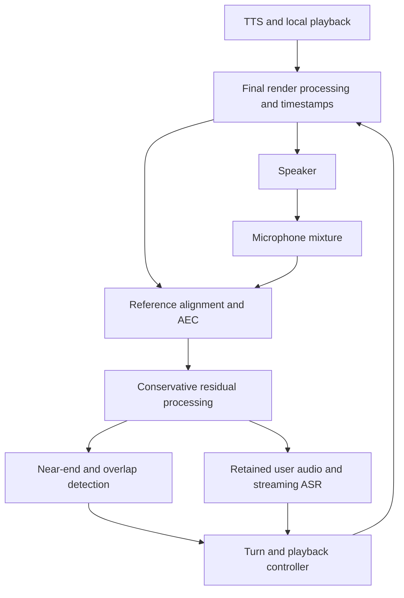

# Voxa: hear the user through playback, without self-interruption

Research and implementation handoff for Strata — 17 November 2026

## 1. Engineering objective

Voxa must keep hearing and retaining the user's speech while she speaks, reject her own acoustic playback as input, yield promptly to a real interruption, and avoid answering before the user has finished. These are four independently testable requirements. Treating them as one microphone sensitivity setting makes improvement in one failure mode hide regressions in another.

The recommended first implementation is a local, continuously running audio front end based on a verified WebRTC AEC3 build, an accurately timed playback reference, conservative residual echo suppression, playback-aware near-end speech detection, retained overlap audio, and an explicit conversation controller. Benchmark neural alternatives behind the same interface. Keep the latency-critical audio path independent of the LLM and avatar.

“Everything from the user, nothing from Voxa” is the product objective. An unconditional guarantee over every room, volume, microphone, and driver is physically unachievable: clipping can destroy information, and an unknown external loudspeaker is not the same problem as known local playback. Define supported operating conditions, test the difficult boundaries, and expose a measurable failure rate. Superiority to Siri/Alexa/Google must come from controlled comparisons, not architectural claims.

Evidence labels used here:

- **Documented deployment:** a vendor explicitly describes a product implementation.
- **Research result:** an experiment supports the method under the paper's conditions.
- **Patent disclosure:** a proposed or claimed mechanism; not proof of deployment or effectiveness.
- **Voxa code observation:** static inspection of the pinned repository snapshot; no live reproduction performed.
- **Recommendation:** an engineering proposal to validate on Voxa.

## 2. The acoustic problem and why common fixes fail

For microphone channel m, model the recorded signal as:

`mic_m(t) = user_m(t) + sum_k[room_path_mk * playback_k](t) + nonlinear_echo_m(t) + noise_m(t)`

The playback waveform is known. The room paths, delay, clock mismatch, loudspeaker distortion, and user's speech are not known exactly. AEC estimates the playback contribution. Residual echo suppression handles what remains. A near-end detector then asks whether an independent person is speaking. Turn-taking asks what that person's speech means for the conversation.

**Cancellation is not ordinary noise reduction.** A noise reducer tries to suppress unwanted sound from its learned characteristics. The device's own TTS is speech and can look exactly like desirable speech. The playback waveform and timing supply causal evidence that a voice came from Voxa. A generic VAD only indicates speech-like sound; it does not establish who produced it. [R1, R2, R3]

**A louder-than-playback gate loses quiet people.** The user can be softer than the echo at the microphone and still be recoverable. Requiring the user to exceed the current playback baseline systematically rejects quiet corrections. Conversely, loud TTS syllables can open a level gate without a user.

**Transcript subtraction loses legitimate words.** If Voxa says “Do you mean the blue one?” and the user answers “the blue one,” word overlap is evidence of conversational relevance as well as possible echo. Matching words cannot decide which source spoke. Use text similarity only as supporting evidence, with audio timing and near-end evidence. Never delete a real user's words merely because Voxa recently said them.

**Muting during TTS defeats full duplex.** It prevents self-triggering by preventing hearing. A short rolling buffer helps only if accepted speech is transferred intact into the user utterance. Detecting an interruption and then asking the user to repeat the request fails the retention objective.

**More suppression is not automatically better.** GStreamer's own documentation says increased echo suppression trades away double-talk performance. Excessive denoising also distorts speech. Test echo removal and user preservation as separate axes. [R3]

**A full-duplex language model does not remove physical echo automatically.** Separate user/assistant model streams still require correct attribution of microphone audio in a loudspeaker installation. Model turn-taking and acoustic echo cancellation solve different problems. [R19]

## 3. What the major companies publicly disclose

### Apple / Siri

Apple's HomePod engineering article documents adaptive multichannel echo cancellation followed by learned residual echo suppression, multichannel filtering, source separation, and trigger-driven stream selection. It explicitly addresses nonlinear playback, double-talk, changing acoustic paths, and competing voices. This is a documented 2018 HomePod implementation, not a specification of every current Siri device. [R1]

**Voxa implication:** combine echo-path modeling with a residual stage; preserve microphone channels when available. A single Blue USB microphone can support the initial known-reference AEC baseline, but cannot supply a spatial microphone array merely by exposing stereo channels.

Apple's *Talking Turns* study evaluates conversational timing separately from recognition and finds substantial shortcomings in audio foundation models. Its benchmark is useful for premature replies and backchannels, not acoustic echo qualification. [R17]

Apple also exposes Siri Pause Time settings and an option to require “Siri” for interruptions. These are documented user controls, not a disclosure of Siri's internal classifier. Voxa should offer a patience preference while keeping the default capable of short, natural interruptions. [R18]

### Amazon / Alexa

Amazon's implicit AEC research feeds both the microphone mixture and playback reference into keyword and device-directed speech classifiers. It reports a 56% relative false-reject reduction for device-directed detection during playback in its Alexa dataset. This is particularly relevant to a detector that must avoid treating its own output as a new request. It does not demonstrate a 56% improvement in arbitrary transcription. [R2]

Amazon's contextual barge-in study treats interruption verification as a learned classification problem. Its acoustic representation approach improves the speed/quality tradeoff against an ASR-dependent baseline on its study data. It supports a fast acoustic decision path rather than waiting for complete transcription. [R12]

Amazon's natural turn-taking description discusses device directedness, interruption handling, and retaining the playback position so “that one” can refer to the item being read. Its endpointing article combines acoustic cues, partial transcript information, and decoder features. These are separate decisions in Voxa too. [R13, R14]

Amazon also studies asynchronous playback: external wireless speakers introduce time-varying delay and independent clocks. This matters for a USB microphone paired with a different output device or Bluetooth speaker. [R11]

### Google / Google Research / WebRTC

WebRTC's public Audio Processing API takes capture and reverse/render audio streams in roughly 10 ms frames. Its AEC3 code provides render buffering, delay control, echo removal, and metrics. This is an inspectable implementation foundation, not evidence that every Google Assistant product uses the identical configuration. [R4, R5]

Current public WebRTC source additionally exposes a neural residual echo estimator and model-loading interface. Availability of those interfaces does not mean the feature or its model is included in Voxa's GStreamer package. Identify the linked library, build revision, configuration, and model assets explicitly. [R6]

Google's *Textual Echo Cancellation* conditions audio enhancement on the source TTS text. It predicts enhanced audio using the microphone mixture and text; it is materially different from deleting matching words from an ASR transcript. Treat it as an experimental option when waveform references are unavailable, rather than the first choice when Voxa controls playback. [R7]

Google's VoiceFilter-Lite studies streaming separation for an enrolled target speaker, while its joint endpointing research learns recognition and endpointing together. These address competing people and response timing, respectively; neither substitutes for playback-reference AEC. [R8, R15]

### Microsoft / Teams and other useful research

DeepVQE jointly addresses AEC, noise suppression, and dereverberation with a real-time neural architecture; its publication reports testing for Teams. A different Microsoft study finds advantages to separating echo cancellation from noise/residual processing at matched complexity. These results favor measuring both modular and joint models rather than assuming either architecture always wins. [R9, R10]

The Microsoft AEC Challenge supplies real and synthetic single-talk/double-talk data and perceptual evaluation methods. Its analysis specifically warns that ERLE does not measure double-talk quality. Use it to prevent a “quiet microphone” from being mistaken for successful listening. [R16]

## 4. Patent reading map

Read the mechanism and figures, then compare them with the papers and open implementations. A published patent is not evidence that a named assistant ships the design. Patent documents also do not grant an implementation license; implementation choices need their own license review.

| Publication | Assignee shown | Technical mechanism | Relevance to Voxa |
|---|---|---|---|
| [WO2025136579A1](https://patents.google.com/patent/WO2025136579A1/en), published 2025-06-26 | Google | Linear AEC output plus reference features drive a neural time-frequency echo mask; includes multichannel noise reduction | Closely matches the proposed hybrid architecture. Read abstract, system diagrams, and enhancement flow. |
| [US11727912B1](https://patents.google.com/patent/US11727912B1/en), published 2023-08-15 | Amazon Technologies | DNN generates a nonlinear reference and adaptation step-size information for adaptive filtering | Research route for nonlinear playback and changing paths; preserve near-end speech during adaptation. |
| [US20220369030A1](https://patents.google.com/patent/US20220369030A1/en), published 2022-11-17; corresponding grant US11849291B2 | Apple | Microphone-array beam directed toward playback speakers supplies an echo-dominant reference | Relevant to external speakers and missing digital references; requires spatial information. |
| [WO2021252039A1](https://patents.google.com/patent/WO2021252039A1/en), published 2021-12-16 | Google | Text embedding and alignment/cancellation probabilities condition enhancement of overlapping audio | Illustrates text-conditioned acoustic removal, rather than lexical deletion. |
| [US11798543](https://patents.google.com/patent/US11798543), recorded-media hotword suppression | Google | Detects a watermark associated with playback containing a hotword to decide whether to process following speech | Supplemental playback-origin cue. Does not itself recover user speech from an overlap. |

All five records were opened and their disclosed mechanisms checked. This map does not assert current legal status or that any claim covers Voxa.

**Watermark recommendation:** defer. A robust marker might help recognize Voxa-origin audio across devices, but its survival through resampling, compression, room acoustics, and concurrent speech needs evaluation. Do not make “marker detected” mean “no user present”: a real interruption can coexist with marked playback. A known render waveform is the practical starting point.

## 5. Findings from Voxa's current source

Snapshot inspected: [`crhy/voxa` commit 480d1d7db7766d59df6e58be43526ed733508c7e](https://github.com/crhy/voxa/tree/480d1d7db7766d59df6e58be43526ed733508c7e). Refresh against Strata's checkout before editing. Findings below are static code observations and engineering risks, not measured diagnoses of the user's running installation.

### 5.1 Overlap audio is consumed instead of becoming the request — highest priority

In [`voxa/conversation.py`](https://github.com/crhy/voxa/blob/480d1d7db7766d59df6e58be43526ed733508c7e/voxa/conversation.py#L331), `feed()` sends audio to a five-second barge buffer while normal conversation processing is muted. `candidate_text()` consumes and clears that buffer to transcribe a candidate. `unmute()` also clears the buffer.

In [`voxa/window.py`](https://github.com/crhy/voxa/blob/480d1d7db7766d59df6e58be43526ed733508c7e/voxa/window.py#L3238), the accepted interruption stops playback, unmutes conversation, and arms the next utterance. That path does not transfer the candidate's audio or recognized text into the new request.

**Consequence:** the words used to establish that the user interrupted can be lost to the normal request path. A short request entirely spoken during TTS is especially vulnerable.

**Required change:** candidate inspection must be non-destructive. Pin a timestamped audio span when near-end speech begins; promote the same span into the user utterance on acceptance, then append subsequent audio exactly once. Keep the pre-roll until promotion or explicit rejection. Test frame identifiers for loss and duplication, not just transcript strings.

### 5.2 Short answers can be classified as self-speech

[`voxa/bargein.py`](https://github.com/crhy/voxa/blob/480d1d7db7766d59df6e58be43526ed733508c7e/voxa/bargein.py) returns “own voice” for fewer than three words after its stop-word exceptions. It also uses transcript character similarity and word overlap. Some exceptions depend on whether the stop word occurs in the assistant's own recent speech.

**Consequence:** “yes,” “blue,” “that one,” and other valid brief answers can be rejected without sufficient acoustic evidence. A user saying “stop” while Voxa happens to say that word is an essential counterexample.

**Required change:** treat short length as uncertainty, not evidence of echo. Classify the source from audio/reference features. Add paired fixtures where identical words are spoken by Voxa alone and by the user over Voxa.

### 5.3 Self-speech stripping can delete an intentional repetition

[`voxa/ownspeech.py`](https://github.com/crhy/voxa/blob/480d1d7db7766d59df6e58be43526ed733508c7e/voxa/ownspeech.py) remembers up to three utterances, remains active for six seconds after finishing, and removes matching word runs. `ConversationListener._filter_own_speech()` applies this filter to recognized text.

**Required change:** retain the original transcript and audio. Move textual overlap into a calibrated feature/diagnostic. It must not silently rewrite a confirmed near-end utterance. A fixed six-second lexical exclusion window is not a room echo model.

### 5.4 Interruption gating adds latency and can miss quiet speech

The inspected window defines a 0.4-second barge-in grace period and a further 0.9-second candidate listening interval after its loudness gate opens. The gate needs a settled baseline and multiple elevated level observations. Candidate transcription is called from `_maybe_barge_in()`.

**Consequence:** onset during early playback, quiet speech under strong echo, and brief corrections deserve targeted tests. Do not describe the constants as a guaranteed 1.3-second delay for every case; the gate, polling, and ASR add their own timing.

**Required change:** keep onset detection active from the first rendered frame; express evidence accumulation in milliseconds rather than UI callback counts. Run acoustic classification and ASR outside the GTK thread. Separate the fast decision to yield from final transcript completion.

### 5.5 Reference alignment needs continuous timing

[`voxa/audio.py`](https://github.com/crhy/voxa/blob/480d1d7db7766d59df6e58be43526ed733508c7e/voxa/audio.py) has a custom canceller path with sample counters, a first-reference anchor, and one-time delay estimation from an initial sufficiently loud interval. [`voxa/anc.py`](https://github.com/crhy/voxa/blob/480d1d7db7766d59df6e58be43526ed733508c7e/voxa/anc.py) provides an NLMS-based adaptive filter and double-talk heuristics.

**Required change:** replace arrival-time assumptions with stream timestamps and measured device/queue latency. Track clock drift and route changes continuously. Inspect long-session memory use: the custom reference history grows as blocks are appended. It should have a bounded working set.

Do not interpret lower output energy, or a helper named `erle_db()`, as proof that the user's speech survived.

### 5.6 Existing WebRTC integration is a baseline to qualify

`AudioCapture._start_webrtc()` already constructs a common GStreamer pipeline containing a monitor/probe branch and microphone/DSP branch. This satisfies an important top-level pipeline requirement in GStreamer's documentation. However, the monitor branch is not the actual TTS playback branch; speech playback uses separate pipelines, including an `autoaudiosink` streaming path and a file playback path. Verify effective output routing and timing rather than assuming the default sink monitor matches all playback. [R3]

**Required change:** identify the actual linked WebRTC version. The names `webrtcdsp` and “WebRTC mode” do not prove AEC3 or the newer neural estimator is active. Prefer a controlled render tap at the final application playback path; optionally use a qualified sink monitor to cover other local applications.

### 5.7 Bypasses, dropped frames, and fallback state must be visible

The custom `mix_chunk()` returns raw audio when the current reference window is near-silent. The custom canceller also has quiet-reference/raw pass-through paths. Test them against delayed/reverberant echo after playback ends: silence in the current render block does not imply silence in the room or in the filter's history.

The capture appsinks permit dropped buffers; the conversation queue drops an old item when full. Canceller failure can switch to raw capture. Those are useful resilience choices only when timing gaps and degraded echo protection are reported and handled.

**Required change:** assign frame sequence numbers, measure overruns, and mark raw fallback as unqualified for automatic playback-time commands. Keep capture available and retain audio. If echo protection fails during a response, a controlled pause of output is preferable to silently treating unprocessed playback as a valid new user command. Recovery must not erase an already captured user span.

## 6. Proposed audio and conversation architecture

All choices in this section are recommendations for Voxa, not vendor deployment claims.

### 6.1 Establish one authoritative render timeline

Tap decoded PCM after application mixing, resampling, gain, and any ducking, immediately before submission to the selected output sink. Feed exactly the submitted frames to AEC. MP3 bytes, source text, an animation clock, and queued-but-canceled TTS are not the actual render reference.

If a system mixer later applies transformations, use a validated monitor of the actual sink or account for that behavior explicitly. A monitor can be a correct reference; it must be proven with timestamps and routing tests. It cannot be assumed merely because it is the default output's monitor.

Record the chosen physical sink, microphone identity, channel layout, sample rate, sequence number, stream time, estimated presentation time, queue depth, gain changes, and route generation. Associate every TTS chunk with a response/generation identifier. Track generated, submitted, canceled, and estimated-audible audio separately.

With independently driven stereo outputs, retain both reference channels. Downmixing them before modeling distinct acoustic paths can discard information. If the product intentionally renders mono, model that actual mono signal instead.

Cover all Voxa output paths: streamed TTS, prepared files, offline fallback voices, notifications, earcons, and media Voxa starts. Distinguish “cancel all local playback” from “cancel only Voxa.” Cancellation policy for other applications should be deliberate and visible to the user.

### 6.2 Run AEC continuously and retain its acoustic history

Use the chosen engine's supported frame format. For a WebRTC APM baseline, adapt streams to its roughly 10 ms API frames. Preserve the native hardware rate until there is a reason to resample; 48 kHz processing followed by 16 kHz ASR is an experiment to compare against a well-integrated 16 kHz baseline, not an automatic quality gain. [R4]

Do not reset the canceller at every sentence. Continue advancing it through zero-valued render frames and the acoustic tail after playback ends. A route change, discontinuity, or new sample rate needs an explicit epoch change and recovery process.

Maintain near-end single-talk, playback-only, double-talk, and silence hypotheses. During double-talk, the adaptive update must avoid learning the user's voice into the echo path. Use the engine's validated adaptation machinery rather than a blanket fixed freeze of all learning forever. Distinguish slow clock drift from an abrupt delay jump.

For separate microphone/output clocks, estimate sample-rate mismatch and correct it with controlled asynchronous resampling. Evaluate startup, suspension/wakeup, Bluetooth changes, and long sessions. Legacy Speex documentation clearly illustrates clock and delay sensitivity; Amazon's asynchronous AEC paper discusses more general time-varying wireless conditions. Do not generalize the old Speex limitation into a claim that modern cross-device AEC is impossible. [R11, R20]

### 6.3 Separate echo removal from user attribution

Use at least three evidence streams:

1. **Echo consistency:** aligned reference/microphone coherence, predicted echo, residual echo likelihood, reference activity, and alignment health.
2. **Independent speech:** speech probability and double-talk evidence in the cleaned audio, optionally supported by the raw mixture and linear AEC output.
3. **Conversation evidence:** partial words, wake/stop cues, response context, and optional target-speaker confidence.

A reference-aware onset detector should see the reference even when the enhanced signal still contains residual echo. Amazon's iAEC supplies direct research motivation for this. A residual-echo probability is not simply `1 - user_probability`: echo and a real user can coexist. [R2]

Silero VAD is a practical local speech-probability baseline. It is not an echo detector, speaker verifier, or end-of-turn predictor. Use it after a qualified AEC stage and benchmark its false activations on Voxa-only playback. [R21]

Speaker enrollment can help distinguish another person or TV from the intended user. It is optional evidence rather than a hard requirement for every short utterance: a 100 ms “no” may not contain enough identity information. Also test Voxa using a clone or close match of the user's own voice; causal reference timing must still distinguish the sources. VoiceFilter-Lite provides a research direction for enrollment-conditioned separation. [R8]

### 6.4 Preserve speech before deciding what to do with it

Maintain bounded timestamped buffers of raw capture, render reference, and enhanced capture. Keep approximately 0.5–1.0 seconds of pre-roll as an initial tuning range. This is an engineering starting point, not a scientific threshold. On speech onset, pin the relevant span so a rolling-buffer trim cannot overwrite an active utterance.

Continue collecting the whole user turn through TTS playback, interruption decisions, ASR startup, and output cancellation. A classifier reads a snapshot; it never consumes the only copy. A rejected candidate may be released after its evidence window, while a confirmed user span is promoted exactly once.

Allow long requests to continue beyond the five-second candidate buffer. Use bounded chunked utterance storage and incremental ASR rather than letting the active request vanish when a ring rolls over. Maintain a separate stable transcript prefix and revisable suffix; do not repeatedly execute commands from partial ASR.

Keep diagnostic audio in RAM by default, with explicit opt-in recording for reproducible tests. Export only selected test recordings. Continuous local capture for active voice operation does not require permanent recording of the room.

### 6.5 Use explicit playback and turn states

Suggested states: `LISTENING`, `USER_TURN`, `PLANNING`, `SPEAKING`, `OVERLAP_PENDING`, `YIELDED`, and `RECOVERING_AUDIO`. These are application states; AEC/capture keep running across them.

| Event | Required behavior |
|---|---|
| Playback-only echo | Continue playback; do not create a user turn or trigger a command. |
| Possible independent user onset | Pin audio immediately; accumulate evidence without deleting it. |
| Confirmed correction, request, or stop | Yield; cancel stale response output; continue the same user turn from retained pre-roll. |
| Brief acknowledgment/backchannel | Retain and interpret it; normally keep speaking unless the context makes it an answer or correction. |
| User repeats words Voxa just spoke | Preserve the words; decide from source evidence and context. |
| User pauses mid-request | Hold the floor when acoustic/linguistic evidence indicates continuation. |
| User resumes during response preparation | Invalidate the pending response before it starts; merge continuation correctly. |
| Audio alignment fails | Enter recovery, retain capture, and prevent unqualified automatic commands from playback contamination. |

A possible low-latency strategy is a reversible pause once independent user speech is strongly supported, followed by semantic classification of whether to stop or resume. An immediate output change for every raw VAD event would reintroduce self-interruption. Calibrate the provisional action on the false-pause rate too. Do not globally lower system volume as a way to pass tests.

A short “yes” is not always a backchannel: when Voxa asks a yes/no question, it may be the complete answer. “That one” requires the audible playback position, not the last generated token. “No, the other one” should yield quickly even though it is not a stop-word command.

### 6.6 Endpoint on completeness and timing, not silence alone

Combine VAD offset, prosody, partial transcript syntax, interaction history, and a learned completion score. VAP models future voice activity; TurnGPT supplies lexical turn-completion evidence. Amazon and Google both publish methods going beyond a fixed silence timer. Domain adaptation is necessary: conversational training data do not guarantee good behavior on a single user's commands. [R14, R15, R22, R23]

For a first baseline, make silence timing adaptive and preserve continuation audio while endpoint confirmation is pending. Give incomplete phrases and hesitations longer patience. Avoid treating a tool router's first valid command match as proof that the person is finished: “open the browser ... and go to my music page” starts with an executable command but continues.

Keep fast acoustic onset decisions separate from slower semantic endpoint decisions. The main LLM may prepare a speculative response, but it must not speak or execute a partial command merely because speculation completed. Tune patience for rhY's speaking style, then verify that it generalizes to held-out speech and other speakers.

### 6.7 Cancel output at every layer

On an accepted interruption, invalidate the old response generation, cancel synthesis/prefetch, flush queued playback, stop future chunks, and update the face/lip-sync pipeline. Ignore stale callbacks by generation identifier. Preserve the history of what was actually audible, including any device queue tail.

An application `stop()` callback is not proof the loudspeaker stopped at that instant. Measure physical last-audible-sample latency with loopback/acoustic fixtures. AEC must continue handling the already-played sound and room reverberation after software cancellation.

Voxa already uses cancellation events in its speech service. Extend and measure that behavior across all playback/fallback paths rather than replacing it wholesale.

### 6.8 Keep audio deadlines independent of model workload

For rhY's Spaced Linux setup, use native audio integration compatible with the actual PulseAudio/PipeWire stack and SysVinit; do not introduce a systemd dependency. Prefer a native C/C++ audio worker and CPU inference for the small detectors so the LLM and avatar cannot starve the audio pipeline on the GPU.

No ASR, network calls, model inference, unbounded allocation, or blocking UI work in a real-time audio callback. Feed bounded queues; instrument deadline misses. A full queue is a detectable error, not permission to silently lose the start of the user's sentence. Test with the real local LLM and face animation under load.

## 7. Implementation candidates and reading priorities

| Candidate | Evidence / availability | Recommended role | Qualification issue |
|---|---|---|---|
| WebRTC AEC3 / APM | Public reference implementation and APIs | First production baseline | Verify actual build and route/timestamp integration; do not infer version from wrapper name. |
| GStreamer `webrtcdsp` + `webrtcechoprobe` | Existing Voxa integration; public plugin docs | Fast comparison with a correctly wired graph | Probe/DSP pipeline rules, supported formats, linked WebRTC revision. |
| PipeWire echo-cancel module | Official virtual sink/source integration | Optional platform-owned reference/capture path | Avoid changing global default devices; qualify only one active AEC owner. |
| DTLN-AEC | Author repository with pretrained TFLite models; code MIT | Reproducible neural AEC baseline | Streaming state, delay compensation, compute budget, and model distribution terms. |
| NKF-AEC | Author code and pretrained model; ICASSP 2023 work | Lightweight learned adaptive-filter experiment | It is a linear AEC; delay compensation is still needed. |
| DeepVQE | Peer-reviewed Microsoft work | Strong joint neural architecture to compare | Paper result is not a ready-to-ship package; find usable weights/implementation separately. |
| LocalVQE | Maintainer repository with C++/GGML and PyTorch paths | Promising local CPU experiment | Repository speed/latency claims need reproduction; evaluate distortion and failure cases independently. |
| Silero VAD | Local PyTorch/ONNX implementation; MIT | Speech probability baseline | Does not independently identify echo or the intended speaker. |
| VAP / TurnGPT family | Published acoustic/linguistic turn-taking research | Endpointing and floor-control experiments | Domain adaptation, clean channel inputs, and inference latency. |
| DeepFilterNet / RNNoise class | Noise suppression models | Optional mild noise cleanup | Ordinary noise reduction alone does not solve known-playback echo. |
| Moshi | Open full-duplex speech model research | Longer-term conversational behavior experiment | Requires qualified acoustic input and substantial model/runtime evaluation. |

Use one owner for AEC: either the application or a qualified platform path. Cascading unrelated echo cancellers and gain controls makes diagnosis difficult and can remove near-end speech. A system-owned backend is an option, not a requirement to reconfigure the user's desktop globally.

New research worth monitoring, but not the first dependency:

- **DiffVQE2 (2026):** authors report causal, lower-delay diffusion-based echo/noise control beating compared discriminative models on their test setup. Reproduce latency, weights, runtime, and word preservation before adoption. [R29]
- **HiThink Turn (2026):** separates response intent from semantic completeness and conditions on playback state. Relevant to distinguishing a complete backchannel from an incomplete but urgent correction. Treat reported results as research claims. [R30]
- **ECHO (2026):** paired Chinese-language cases share overlap words but require different keep/yield decisions based on context. Borrow its matched-pair evaluation design; it is not an English acoustic-echo benchmark. [R31]

## 8. A benchmark that can establish actual superiority

### 8.1 Test both the front end and the whole interaction

Build three levels of reproducible evaluation:

1. **Digital component tests:** known clean user speech, known render signal, simulated echo, and noise. Useful for exact signal comparisons, adaptation, deliberate timing faults, and regressions.
2. **Physical acoustic tests:** the actual microphone and speakers in real rooms, with real output queues, clipping, gain controls, motion, and clock mismatch. Synthetic convolution alone misses important failures.
3. **End-to-end interaction tests:** actual Voxa speech playback, interruption classification, transcript retention, turn completion, cancellation, avatar load, and tool execution. AECMOS or a clean WAV alone does not establish this behavior.

Use public AEC Challenge train/development material for development and a genuinely held-out set for the final comparison. Add Voxa-specific TTS voices and hardware conditions. Do not train on the same room/speaker/utterances used to claim a win. [R16]

### 8.2 Required test matrix

| Dimension | Cases |
|---|---|
| Speech combination | User only; Voxa only; neither; simultaneous speech; user begins during an echo tail. |
| Playback content | Every supported TTS voice; offline fallback; music; podcast; earcons; Voxa saying her wake word and stop/cancel/offline phrases. |
| User utterance | “yes”; “no”; “blue”; “that one”; “stop”; “no, the other one”; long request; deliberate repetition of Voxa's exact words. |
| Overlap position | At playback onset; first syllable; middle; final word; immediately after cancellation. Randomize onset continuously as well as using fixed offsets. |
| User/echo level | User stronger, equal, and weaker than echo; quiet speech; whispers as a separately reported condition. Specify ratios at the microphone, not just volume-slider values. |
| Environment | Quiet room, reverberant room, fans, typing, music, competing TV speech, and another nearby person. |
| Distance / position | Close mic; typical desk position; farther away; off-axis; moving user; moved mic or speaker. |
| Routing | Same-device I/O; USB mic plus separate output; wired headphones; laptop speakers; Bluetooth; device unplug/replug; changed default sink. |
| Timing faults | Clock drift, dropped render/capture blocks, delayed reference, route epoch change, source suspension/wakeup. |
| User pacing | Breath, hesitation, mid-sentence silence, fillers, self-correction, list dictation, complete command followed by an added clause. |
| Load | Idle; ASR busy; local LLM active; avatar active; CPU pressure; GPU pressure; long continuous session. |
| Identity | Different accents and voices; user similar to TTS; optionally user-cloned TTS; enrolled and unenrolled users. |

Use calibrated injected or recorded user audio for repeatability, then verify with live human speech. Played-back user recordings are useful acoustic stimuli but not a complete substitute for real conversational behavior. Keep test-fixture playback out of Voxa's echo-reference cancellation policy when it represents the human; otherwise the harness can accidentally cancel the test user and invalidate the results.

### 8.3 Report these metrics separately

| Metric | Definition / purpose |
|---|---|
| Self-interruption rate | False output pauses/stops caused by Voxa-only playback; report per response and per playback hour. Include provisional pauses. |
| Self-command rate | Playback-only speech that creates a user turn, request, or tool execution. A separate, more serious failure than harmless partial ASR. |
| User-onset recall | Fraction of annotated real user onsets retained/detected, broken out by level, word length, and overlap position. |
| Barge-in recall | Fraction of actual intended interruptions on which Voxa yields. Do not count all acknowledgments as desired interruptions. |
| Word error rate | `(substitutions + deletions + insertions) / reference_words`, separately for user-only and overlap. |
| User-word deletion rate | Words lost from known user speech; highlights over-suppression and buffer loss. |
| Leading-word retention | First word/syllable retained, especially for short overlap requests. |
| Turn retention | Accepted overlap audio promoted once; no missing or duplicate frame identifiers. |
| Stop latency | User onset to physical playback cessation, plus onset-to-decision and decision-to-device-stop breakdowns; median/p95/p99. |
| Premature response rate | Voxa starts speaking or executes before the annotated user turn ends. |
| Response latency | True user-turn end to first audible appropriate response, conditional on correctness. |
| Backchannel keep accuracy | Continues appropriately when the overlap should not take the floor. |
| Pair accuracy | Both keep and yield examples with matched words are correct; defeats always-stop policies. |
| AECMOS / listening quality | Echo annoyance and user speech quality, with blinded listening where possible. |
| Echo-path recovery | Time to recover after a path/route change; count false triggers during recovery. |
| Transport health | Dropped samples, callback misses, queue overruns, drift, reference availability, and clipping. |

ERLE is a supplemental playback-only measure under suitable conditions. Do not optimize microphone/output energy ratios during double-talk: removing the user also improves that ratio. Microsoft explicitly discusses this limitation. [R16]

### 8.4 Proposed acceptance gates

These numbers are proposed product targets, not reported Voxa performance and not thresholds taken from the papers. Calibrate difficulty and measurement uncertainty before making them release gates.

- Zero self-generated commands and zero false playback stops in 10,000 varied Voxa-only response trials, with all voices and ordinary supported playback levels represented.
- At least 99% intended interruption recall in the declared normal-use range, with every test cell's counts reported. Report difficult quiet/far-field cells separately rather than hiding them in an average.
- At least 99% leading-word retention in supported-condition overlap tests, and zero transport loss/duplication in accepted user spans.
- Initial target for normal-condition physical stop latency: median at or below 200 ms, p95 at or below 350 ms. Evaluate the false-pause tradeoff at that operating point.
- No statistically meaningful user-only WER regression versus the same recognizer on the baseline microphone route; define a practical non-inferiority margin before testing. For overlap, report WER and deletions relative to matched no-playback user recordings.
- Premature replies below a predeclared threshold on held-out natural pauses and corrections; an initial goal of below 1% is reasonable to test. Publish latency alongside this result.
- Long-duration playback-only soak testing on the real desktop route. Zero events in 100 hours implies an approximate one-sided 95% Poisson upper bound of 0.03 events/hour, not proof of zero risk forever. Zero in 10,000 independent response trials gives an approximate upper bound of 0.03% per trial; repeated correlated recordings provide less evidence.

### 8.5 Compare against Siri, Alexa, and Google fairly

Test actual named devices/software versions and record their settings. Randomize identical utterances, positions, interruption timing, noise, and comparable acoustic playback levels. Keep wake-word requirements explicit. Run repeated trials across speakers and rooms, report confidence intervals and per-condition results, and preserve the test manifest.

Separate a **product comparison** using each vendor's complete hardware from a **front-end comparison** where all candidate Voxa algorithms receive identical recordings. A desktop Blue microphone versus a purpose-built array is a system comparison, not an isolated algorithm comparison.

If a competitor exposes no transcript, score command content through task outcomes and human annotation; do not invent comparable WER values. If settings forbid wake-word-free interruptions, report that operating constraint. A win on a declared desktop test suite supports a scoped claim, not “better in every room on every device.”

Use *Talking Turns* and *Full-Duplex-Bench* to guide interactive tests in addition to AEC Challenge acoustic tests. A benchmark where user and assistant are supplied as clean independent streams does not measure loudspeaker echo rejection. [R17, R24]

## 9. Ordered implementation work for Strata

### Milestone A — establish evidence and stop losing words

1. Refresh the pinned source findings against the current checkout; identify the audio backend and active AEC build on rhY's machine.
2. Add timestamped/sequence-numbered capture, render, enhanced-audio spans and interruption decision logs. Keep recordings opt-in.
3. Write regression fixtures for overlap promotion, short answers, exact repetition, stop during Voxa's own stop-word playback, and user continuation during response preparation.
4. Change barge-in candidate inspection to non-destructive reads. Promote accepted audio into the actual request with pre-roll and deduplication.
5. Replace blanket short-utterance rejection and destructive lexical filtering with explicit uncertainty and acoustic evidence.

Deliverable: replayable fixtures demonstrate retained first/last words before changing the AEC algorithm.

### Milestone B — qualify the playback reference and AEC

1. Establish a controlled render tap for every output path; verify actual physical sink identity.
2. Wire a known AEC3 build or prove the current wrapper's implementation; compare against the current custom path.
3. Measure delay, jitter, drift, echo-tail handling, and recovery on actual hardware.
4. Ensure one AEC owner and a visible degraded state. Bound memory and count dropped frames.
5. Establish user-only, playback-only, and double-talk scores before adding stronger enhancement.

Deliverable: an acoustic benchmark report with raw/enhanced matched clips and transport telemetry.

### Milestone C — natural interruptions without self-triggering

1. Add a reference-aware near-end/double-talk detector; calibrate against Voxa-only playback.
2. Separate onset retention, provisional yield, semantic keep/yield classification, and complete ASR.
3. Move interruption work off the UI thread. Remove the fixed startup blind interval once the detector passes onset tests.
4. Cancel synthesis, queued audio, stale generations, and avatar output coherently. Measure physical stop latency.

Deliverable: joint recall/false-pause curves, with “yes,” “that one,” and quiet corrections included.

### Milestone D — endpointing and neural improvements

1. Add adaptive completion/continuation handling, then compare learned acoustic and lexical turn models.
2. Evaluate residual neural processing, DTLN-AEC, NKF-AEC, and LocalVQE behind one interface. DeepVQE/DiffVQE2 are research directions where usable deployment assets can be verified.
3. Add optional speaker conditioning only if it improves held-out user retention without rejecting short speech.
4. Complete long-session, route-change, natural-pause, and competitor comparisons.

Deliverable: release decision based on multiple metrics, plus a scoped evidence-based comparison claim.

## 10. Copyable instruction for Strata

> Make reliable full-duplex hearing Voxa's highest priority. Preserve all user audio while Voxa speaks; reject Voxa-origin playback using an accurately timed audio reference and validated AEC; distinguish independent user speech from residual echo; and make turn-taking decisions separately from speech detection.
>
> Start by verifying the code findings in this document. Fix the consumed/cleared overlap buffer, blanket short-utterance self-speech classification, and destructive transcript overlap removal. Retain the beginning of every accepted interruption and promote its existing audio into the real user turn exactly once. Do not require the user to repeat it.
>
> Qualify one known AEC3 or equivalent backend with a post-processing render reference, continuous timestamps, delay/drift handling, room-tail processing, and explicit health states. Verify all streamed, file, fallback, and notification output paths. Do not infer AEC3 availability from a wrapper name. Keep capture running during playback and endpoint confirmation.
>
> Keep the fast audio path independent of GTK, the LLM, and face generation. Use acoustic evidence for quick onset/yield decisions, streaming ASR for words, and acoustic plus linguistic evidence for turn completion. Never suppress an utterance solely because it is short, quieter than playback, matches Voxa's recent wording, or resembles her speaker identity.
>
> Add the supplied regression matrix and metrics before tuning thresholds. Optimize user-word retention and false self-interruptions jointly. A muted microphone, always-yield policy, lower system volume, or huge silence timeout is not a passing solution. Report real measured results and operating conditions; do not claim perfect hearing or superiority over commercial assistants without controlled tests.
>
> Use the primary sources below for the acoustic front end, reference-aware detection, turn-taking, patents, and evaluation. Keep research claims separate from shipped capabilities. Deliver the fixes in the milestone order, with reproducible recordings, timing traces, and pass/fail evidence.

## 11. Annotated primary-source bibliography

Annotations below identify why to read each source; they are not endorsements of untested performance in Voxa. Patent records are listed in Section 4. Repository contents and build availability should be pinned when implemented.

### Core reading: acoustic front end and playback-aware detection

**R1. Apple Audio Software Engineering and Siri Speech Team, “Optimizing Siri on HomePod in Far-Field Settings” (2018).** [Official article](https://machinelearning.apple.com/research/optimizing-siri-on-homepod-in-far-field-settings). Read the MCEC, residual echo suppression, and source-selection sections. Best direct public explanation here of a shipped smart-speaker front end.

**R2. Cornell, Balestri, Sénéchal, “Implicit acoustic echo cancellation for keyword spotting and device-directed speech detection.”** [Publication record](https://www.amazon.science/publications/implicit-acoustic-echo-cancellation-for-keyword-spotting-and-device-directed-speech-detection), [paper](https://cdn.amazon.science/e5/c8/47db462c4815b13397f0d7fcd186/implicit-acoustic-echo-cancellation-for-keyword-spotting-and-device-directed-speech-detection.pdf). Official record labels 2022; PDF carries 2023 proceedings copyright. Read reference fusion, training augmentation, and playback/non-playback evaluation. It studies classification, not general waveform recovery.

**R3. GStreamer, `webrtcdsp` documentation.** [Official documentation](https://gstreamer.freedesktop.org/documentation/webrtcdsp/webrtcdsp.html). Operational rules for probe placement, common pipeline, sample rates, suppression tradeoffs, and configuration. Directly relevant to existing Voxa code.

**R4. WebRTC, Audio Processing API.** [Current header](https://webrtc.googlesource.com/src/+/refs/heads/main/api/audio/audio_processing.h). Read stream contracts, frame sizes, threading assumptions, reverse stream, and configuration. This is a moving source: pin a revision for implementation.

**R5. WebRTC, AEC3 implementation interfaces.** [EchoCanceller3 header](https://webrtc.googlesource.com/src/+/992a96f68e4cadc69ff85ffe85500010e761e2bd/modules/audio_processing/aec3/echo_canceller3.h). Shows render analysis, capture processing, delay interface, metrics, and multichannel configuration. Use source-level verification instead of assuming a wrapper exposes everything.

**R6. WebRTC, neural residual echo estimation implementation and creator.** [Implementation](https://webrtc.googlesource.com/src.git/+/f7f889c4834cf3e5c34c02f580017283499ba48b/modules/audio_processing/aec3/neural_residual_echo_estimator/neural_residual_echo_estimator_impl.cc), [creator interface](https://webrtc.googlesource.com/src.git/+/526e228d25f83b1023760d3835f33d622c7b9f5f/api/audio/neural_residual_echo_estimator_creator.h). Inputs include microphone, linear-AEC, and reference frames. Useful recent implementation evidence; a model-loading API is not proof that a model is bundled in a downstream package.

**R7. Ding, Jia, Hu, Wang, “Textual Echo Cancellation,” ASRU 2021.** [Google publication](https://research.google/pubs/textual-echo-cancellation/), [paper record](https://arxiv.org/abs/2008.06006), [author demo](https://google.github.io/speaker-id/publications/TEC/). Read as text-conditioned acoustic enhancement, not transcript filtering. Original preprint is 2020; use the cited proceedings version when reproducing the historical result.

**R8. Wang et al., “VoiceFilter-Lite: Streaming Targeted Voice Separation for On-Device Speech Recognition,” Interspeech 2020.** [Google publication](https://research.google/pubs/voicefilter-lite-streaming-targeted-voice-separation-for-on-device-speech-recognition/). Useful for optional target-user separation and the requirement not to hurt recognition when no competing speaker is present.

**R9. Indenbom, Ristea et al., “DeepVQE: Real Time Deep Voice Quality Enhancement for Joint Acoustic Echo Cancellation, Noise Suppression and Dereverberation,” Interspeech 2023.** [Proceedings entry](https://www.isca-archive.org/interspeech_2023/ristea23_interspeech.html), [paper](https://www.isca-archive.org/interspeech_2023/ristea23_interspeech.pdf). DOI 10.21437/Interspeech.2023-1028. Joint neural enhancement reference; test word preservation as well as acoustic quality.

**R10. Braun and Valero, “Task Splitting for DNN-Based Acoustic Echo and Noise Removal.”** [Microsoft-hosted paper](https://www.microsoft.com/en-us/research/uploads/prod/2022/07/Paper_E12.pdf). Compares joint and separated tasks at comparable complexity. Read the double-talk and near-end distortion analysis when choosing modular versus end-to-end enhancement.

**R11. Ayrapetian et al., “Asynchronous acoustic echo cancellation over wireless channels” (2021).** [Amazon publication](https://www.amazon.science/publications/asynchronous-acoustic-echo-cancellation-over-wireless-channels), [paper](https://cdn.amazon.science/10/d9/f1bd1ff942ec991cf5ff04adb882/asynchronous-acoustic-echo-cancellation-over-wireless-channels.pdf). Read the delay/clock mismatch discussion and microphone-array approach. It does not give a universal fix for an arbitrary single-mic Bluetooth setup.

### Interruption and endpointing

**R12. Bekal et al., “Contextual acoustic barge in classification for spoken dialog systems,” Interspeech 2022.** [Amazon publication](https://www.amazon.science/publications/contextual-acoustic-barge-in-classification-for-spoken-dialog-systems), [paper](https://assets.amazon.science/56/4a/d81efc094934a2fdafdbe03d63f0/contextual-acoustic-barge-in-classification-for-spoken-dialog-systems.pdf). Supports learned interruption verification and the latency value of not depending on full ASR output.

**R13. Amazon Science, “New Alexa features: Natural turn-taking” (2020).** [Official explanation](https://www.amazon.science/blog/change-to-alexa-wake-word-process-adds-natural-turn-taking). Useful for device directedness, contextual barge-in, audible playback position, and user pacing. Distinguish announcement plans from deployed behavior on any particular Echo version.

**R14. Maas, “Alexa scientists address challenges of end-pointing” (2018).** [Official explanation](https://www.amazon.science/blog/alexa-scientists-address-challenges-of-end-pointing). Describes acoustic and lexical classifiers with ASR decoder features, and the early/late endpoint tradeoff. Links the corresponding ICASSP work.

**R15. Chang et al., “Joint Endpointing and Decoding with End-to-End Models,” ICASSP 2019.** [Google publication](https://research.google/pubs/joint-endpointing-and-decoding-with-end-to-end-models/). Reports reduced endpointing latency without quality loss on its Voice Search task. Do not equate its endpointing result with total assistant response latency.

**R17. Arora et al., “Talking Turns: Benchmarking Audio Foundation Models on Turn-Taking Dynamics” (2025).** [Apple research page](https://machinelearning.apple.com/research/talking-turns). Evaluates timing behavior and highlights aggressive interruption and limited backchanneling. Follow the page's paper/code links when constructing a comparable evaluation.

**R18. Apple, Siri accessibility settings.** [Official guide](https://support.apple.com/en-gb/guide/iphone/iphaff1d606/ios). User-facing pause-time and interruption controls. A source for exposed behavior/preferences, not internal algorithm claims.

**R19. Défossez et al., “Moshi: a speech-text foundation model for real-time dialogue” (2024).** [Paper](https://arxiv.org/abs/2410.00037). Parallel user/assistant speech streams enable full-duplex dialogue modeling. Its model latency is not a measurement of acoustic echo cancellation or desktop output cancellation.

**R22. Ekstedt and Skantze, “Voice Activity Projection: Self-supervised Learning of Turn-taking Events” (2022).** [Paper](https://arxiv.org/abs/2205.09812). Acoustic prediction of future speech activity and turn/backchannel events. Read training/task definitions before adopting a model for Voxa commands.

**R23. Ekstedt and Skantze, “TurnGPT: a Transformer-based Language Model for Predicting Turn-taking in Spoken Dialog,” Findings of EMNLP 2020.** [ACL paper record](https://aclanthology.org/2020.findings-emnlp.268/), [author implementation](https://github.com/ErikEkstedt/TurnGPT). Linguistic completeness evidence complements, but cannot replace, acoustic source separation.

### Reproducible evaluation and local implementations

**R16. Cutler et al., “ICASSP 2023 Acoustic Echo Cancellation Challenge.”** [Paper](https://arxiv.org/abs/2309.12553), [full text](https://arxiv.org/html/2309.12553v1), [official data/code repository](https://github.com/microsoft/AEC-Challenge). Covers real-world recordings, synthetic mixtures, double-talk, perceptual metrics, word accuracy, and latency constraints. Essential for avoiding energy-only evaluation.

**R20. Speex, echo cancellation API and troubleshooting.** [Official manual](https://speex.org/docs/manual/speex-manual/node7.html). Classic practical explanation of alignment, filter length, clipping, nonlinearities, and clock constraints. Some limitations are specific to this older implementation.

**R21. Silero Team, Silero VAD.** [Maintainer repository](https://github.com/snakers4/silero-vad). Local speech detector with PyTorch/ONNX paths and MIT license. Verify streaming frame requirements for the pinned model version; do not use speech probability as proof of near-end identity.

**R24. Lin et al., “Full-Duplex-Bench: A Benchmark to Evaluate Full-duplex Spoken Dialogue Models on Turn-taking Capabilities” (2025).** [Paper](https://arxiv.org/abs/2503.04721). Tests pauses, backchannels, turn-taking, and interruption management. Pair with physical echo tests; clean-stream interaction evaluation alone is insufficient.

**R25. Westhausen and Meyer, “Acoustic Echo Cancellation with the Dual-Signal Transformation LSTM Network,” ICASSP 2021.** [Paper record](https://ieeexplore.ieee.org/abstract/document/9413510), [author code/models](https://github.com/breizhn/DTLN-aec). DOI 10.1109/ICASSP39728.2021.9413510. A practical TFLite baseline with multiple model sizes; code is MIT in the repository.

**R26. Yang et al., “Low-Complexity Acoustic Echo Cancellation with Neural Kalman Filtering,” ICASSP 2023.** [Paper](https://arxiv.org/abs/2207.11388), [author code](https://github.com/fjiang9/NKF-AEC), [author demos](https://fjiang9.github.io/NKF-AEC/). Compact learned adaptive filtering, especially relevant to path changes. Repository explicitly notes linear AEC and delay-compensation needs.

**R27. LocalAI, LocalVQE.** [Maintainer repository](https://github.com/localai-org/LocalVQE). CPU-oriented streaming echo/noise enhancement with a C++/GGML path. The README advertises a causal 16 ms hop/latency configuration and Apache-2.0 code; treat these as maintainer claims, verify actual end-to-end latency, and check weight/dependency terms separately.

**R28. PipeWire, Echo Cancel module.** [Official documentation](https://pipewire.pages.freedesktop.org/pipewire/page_module_echo_cancel.html). Documents virtual capture/source and sink/playback streams and the WebRTC backend. Useful platform option where it can be integrated without disrupting the user's chosen device routing.

### Recent research to reproduce before considering deployment

**R29. Lugo et al., “DiffVQE2: An Efficient Low-delay Diffusion Model for Acoustic Echo and Noise Control” (2026).** [Paper record](https://arxiv.org/abs/2609.31703), [IWAENC program abstract](https://iwaenc2026.org/program/poster_93.html). Search-indexed author abstract and conference entry were available; full-text retrieval failed in this review. Relevant causal diffusion work, but no detailed architecture or deployment conclusion is asserted here.

**R30. Chen et al., “HiThink Turn: An Intent-Aware Turn-Taking Control Module for Full-Duplex Dialogue” (2026).** [Paper record](https://arxiv.org/abs/2609.34096). Search-indexed author abstract was available; full-text retrieval failed. Promising distinction between intent and completeness. Do not treat abstract-level benchmark claims as validated Voxa behavior.

**R31. Zhao et al., “ECHO: A Matched-Contrast Benchmark for Context-Sensitive Turn-Taking in Full-Duplex Dialogue” (2026).** [Paper record](https://arxiv.org/abs/2609.17360). Reviewed at indexed-abstract level. Its matched-context design is useful for exposing always-yield bias, with language/domain limitations stated above.

### Supplemental robustness reading

**R32. Huang, Skoglund, Luebs, “Bi-Magnitude Processing Framework for Nonlinear Acoustic Echo Cancellation on Android Devices,” IWAENC 2016.** [Google publication](https://research.google/pubs/pub45526). Explains how device dynamic-range processing creates fast-varying nonlinear echo behavior; relevant to why an otherwise correct reference can mismatch real loudspeaker output.

**R33. Schröter et al., DeepFilterNet / DeepFilterNet2.** [Original paper](https://arxiv.org/abs/2110.05588), [embedded real-time paper](https://arxiv.org/abs/2205.05474), [maintainer repository](https://github.com/Rikorose/DeepFilterNet). Useful noise-cleanup background. These ordinary enhancement references are not evidence that a reference-free denoiser solves Voxa's self-playback problem.

## 12. Completion and limits of this research pass

This handoff contains 33 numbered research/documentation/implementation references, five patent records, and pinned observations from Voxa's source. Core recommendations are grounded in vendor engineering descriptions, published papers, official APIs, and author/maintainer repositories. Recent research with only indexed abstracts available is labeled accordingly.

No Voxa code was changed, no live microphone tests were run, and no message or issue was posted. The next engineering action is Milestone A: prove that accepted overlap speech reaches the actual user request intact, then qualify the acoustic front end against the joint retention/self-interruption benchmark.
